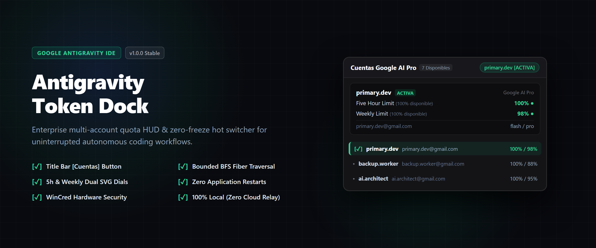
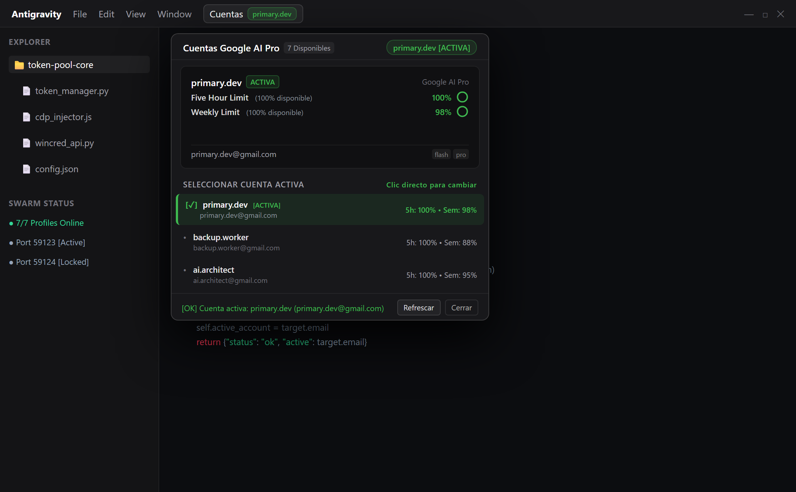
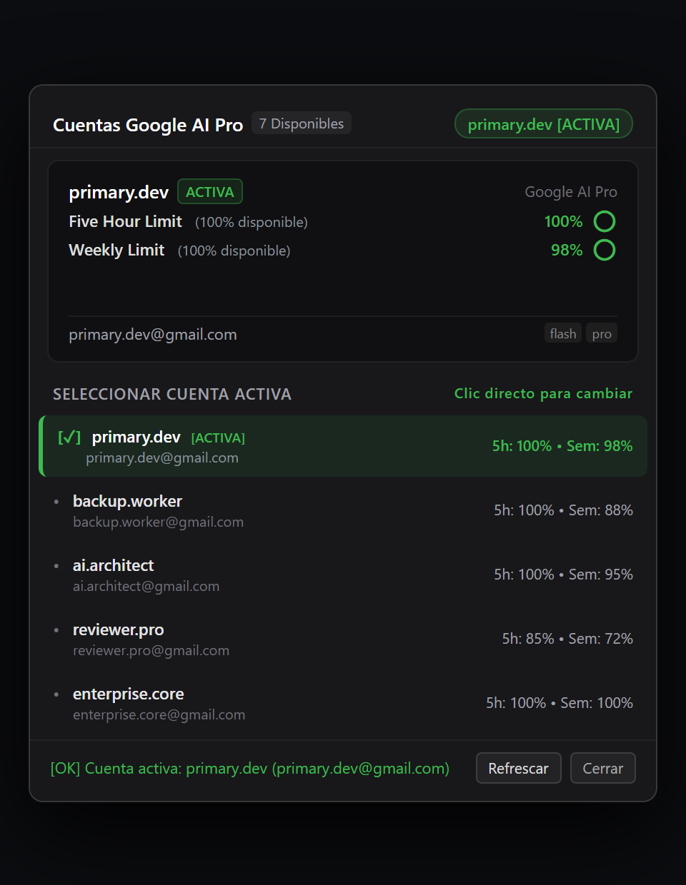
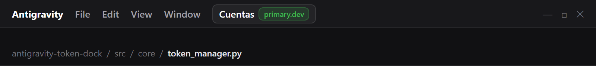

<div align="center">



# Antigravity Token Dock v1.0.0

**Native Title Bar Multi-Account Switcher & Real-Time Quota Manager for Google Antigravity IDE**

[](https://github.com/BryanGM12/antigravity-token-dock/releases)
[](https://microsoft.com)
[](https://www.python.org/)
[](LICENSE)
[](#features--guarantees)

[Features](#features) • [Showcase](#showcase) • [Installation](#installation) • [Configuration](#configuration) • [Usage](#usage) • [Commands](#cli-commands) • [License](#license)

</div>

---

## Overview

When coding or running long-running agent tasks in **Google Antigravity IDE**, hitting the 5-hour rolling limit or exhausting weekly quotas interrupts your workflow.

**Antigravity Token Dock** injects a native `[Cuentas]` button directly into the Antigravity desktop title bar (right next to the `Window` menu). It lets you inspect live quotas across your pool of accounts and switch identities instantly with a single click — **without restarting the Antigravity window, losing open tabs, or opening external browsers**.

---

## Features

- **1-Click In-App Account Switching**: Click any account in the dropdown menu to instantly rotate credentials in runtime memory.
- **Dual Live Quota Rings**: View real-time 5-hour rolling limits and weekly quota percentages with color-coded circular dials (Green >50%, Amber 15-50%, Red <=15%).
- **Zero Window Restarts**: Workspace folders, editor tabs, active terminals, and agent conversations remain completely uninterrupted during rotation.
- **Auto-Closing Dropdown**: Selecting an account displays visual confirmation (`[✓]`) and automatically closes the menu after 400ms.
- **Zero Browser Popups**: Automatically neutralizes unwanted browser popups and onboarding security dialogs.
- **100% Local & Private**: Credentials are encrypted locally via Windows Credential Manager (`advapi32.dll`). No data is sent to external servers or telemetry collectors.

---

## Showcase

<div align="center">

| Title Bar Account Selector & Live Quotas | Focused Dual Quota HUD Card |
| :---: | :---: |
|  |  |
| *Native title bar menu showing configured accounts and live percentage dials.* | *Compact HUD displaying 5-hour and weekly quotas with exact refresh countdowns.* |

<br/>

### Seamless Title Bar Integration


*Integrated directly into the native title bar next to `Window`, displaying the active account alias in real time.*

</div>

---

## Installation

### Prerequisites
- **Operating System**: Windows 10 or Windows 11 (64-bit)
- **Python**: Version 3.10 or higher
- **Antigravity IDE**: Installed on the system

### Quick Setup

```powershell
# 1. Clone repository
git clone https://github.com/BryanGM12/antigravity-token-dock.git
cd antigravity-token-dock

# 2. Install lightweight dependencies
pip install -r requirements.txt

# 3. Start background services
.\antigravity-monitor.ps1 start
```

---

## Configuration

Antigravity Token Dock reads account profiles from `~/.gemini/profiles/<alias>/`.

To configure your accounts:

1. Create a directory for each profile:
   ```text
   C:\Users\<YourUser>\.gemini\profiles\
   |-- primary.dev\
   |   `-- .gemini\
   |       |-- oauth_creds.json
   |       `-- gemini-credentials.json
   |-- backup.worker\
   |   `-- .gemini\
   |       |-- oauth_creds.json
   |       `-- gemini-credentials.json
   ```

2. Each profile contains standard Google OAuth credential tokens generated during Google AI login.
3. The system automatically detects all configured profiles on startup.

---

## Usage

### 1. Title Bar Menu (GUI)
Once the service is running, start or focus Antigravity:
- Click the **`[Cuentas]`** button in the title bar.
- Review your current active account and quota rings.
- Click any account in the list to switch. The menu confirms the change with `[✓]` and auto-closes.

### 2. PowerShell CLI

You can also manage and inspect accounts directly from terminal:

```powershell
# View quota summary for all configured accounts
.\antigravity-monitor.ps1 status

# Switch active account by alias, slot number, or email
.\antigravity-monitor.ps1 switch primary.dev
.\antigravity-monitor.ps1 switch 2

# Restart background services
.\antigravity-monitor.ps1 restart

# Stop all background services
.\antigravity-monitor.ps1 stop
```

---

## REST API (Port 59123)

A local HTTP server runs on `http://127.0.0.1:59123` for integrations:

| Endpoint | Method | Description |
|---|---|---|
| `/api/tokens` | `GET` | Returns JSON of all accounts, quotas, and active status |
| `/api/switch?account=<alias>` | `GET` | Switches active account to `<alias>` |
| `/api/switch` | `POST` | Switches active account (`{"account": "<alias>"}`) |
| `/api/status` | `GET` | Health check and current active account |

---

## Features & Guarantees

- **Zero Emojis**: Clean, professional typographic design using standard symbols (`[✓]`, `*`, `[ACTIVA]`, `-`).
- **Zero Renderer Freezes**: Bounded React Fiber traversal ensures the UI thread never locks up.
- **Zero Window Reloads**: Language server state is refreshed seamlessly in memory.
- **Port Conflict Protection**: Socket mutexes prevent multiple instances from colliding.

---

## License

This project is licensed under the MIT License. See [LICENSE](LICENSE) for details.
